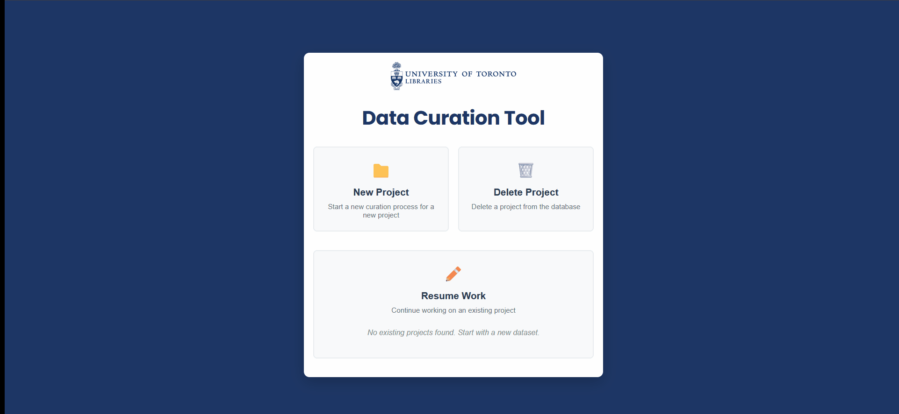

# U of T Dataverse dataset curation tool

> [!WARNING]
> This tool is under active development and is not yet production-ready. Please use it at your own risk.

A dataset curation tool for Dataverse repositories, with a web interface.



📖 **Documentation:** <https://kenlhlui.github.io/pydatacuration-p/>

## 🚀 Quick Start

### Prerequisites
- [uv](https://docs.astral.sh/uv/getting-started/installation/)
- [FFmpeg](https://ffmpeg.org/), to check audio and video files (Optional, but recommended)

### ⚙️ Setup & Run
From the repository root:
```sh
uv sync
touch .env  # then add your settings, see the guide below
mkdir -p workdir
uv run --env-file .env app.py
```
Then open <http://localhost:9005>.

Refer to the [Local Setup Guide](https://kenlhlui.github.io/pydatacuration-p/local_setup/) for the `.env` settings, PostgreSQL, and `just dev-run`. To run the tool with Docker instead, see the [Container Guide](https://kenlhlui.github.io/pydatacuration-p/container/).

## 📚 Guides

### Getting Started
- [Local Setup (uv)](https://kenlhlui.github.io/pydatacuration-p/local_setup/)
- [Container Setup (Docker)](https://kenlhlui.github.io/pydatacuration-p/container/)

### Configuration
- [App Settings (Environment Variables)](https://kenlhlui.github.io/pydatacuration-p/app_settings/)
- [Custom Status Options](https://kenlhlui.github.io/pydatacuration-p/custom_status_options/)
- [Checklist YAML File and Validator CLI](https://kenlhlui.github.io/pydatacuration-p/checklist/)

### Development
- [Database Schema Version](https://kenlhlui.github.io/pydatacuration-p/db_schema_version/)
- [Bump the Version](https://kenlhlui.github.io/pydatacuration-p/version_bump/)
- [Documentation Site](https://kenlhlui.github.io/pydatacuration-p/docs_site/)
