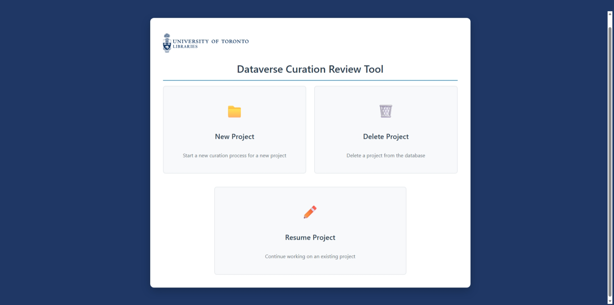

# Landing page
<figure markdown="span">
  { width="800" }<figcaption>Landing page of the U of T Dataverse Curation Tool</figcaption>
</figure>

This is the landing page of the tool. You will have the option to:

1. Start a new dataset review by clicking the '📁New dataset' box.
2. Resume a previous dataset review by clicking the '✏️Resume project' box.
3. Delete a previous dataset review by clicking the '🗑️Delete project' box.