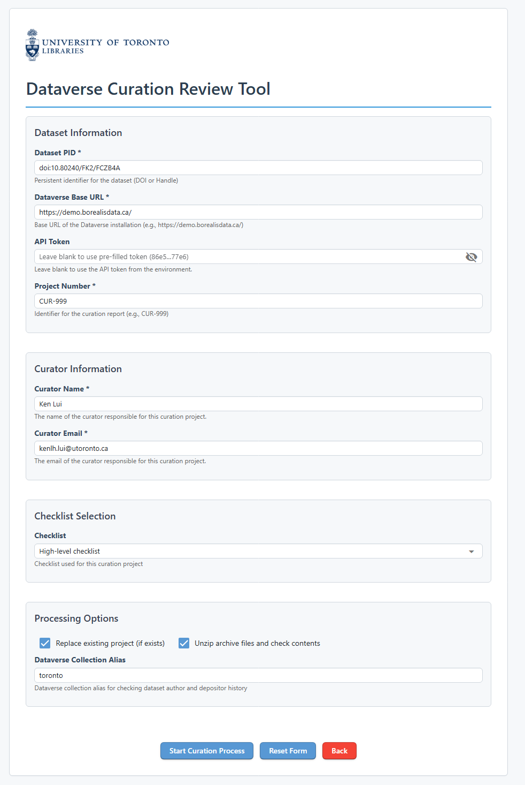

# New dataset page
<figure markdown="span">
  { width="600" }<figcaption>New dataset page of the U of T Dataverse Curation Tool</figcaption>
</figure>

This is the page for starting a new dataset review. Each dataset review is considered a project in the tool. To start a new dataset review, you will need to input information as stated in the form, including the base url of the repository (e.g., https://demo.borealisdata.ca/), API token of your account, the dataset DOI, the project ID, etc. Plus curator information like the name and email of yourself. 

You also have to select the checklist to use for the review, from the dropdown menu.

Once you submit the form, the tool will start the review and redirect you to the checklist page.