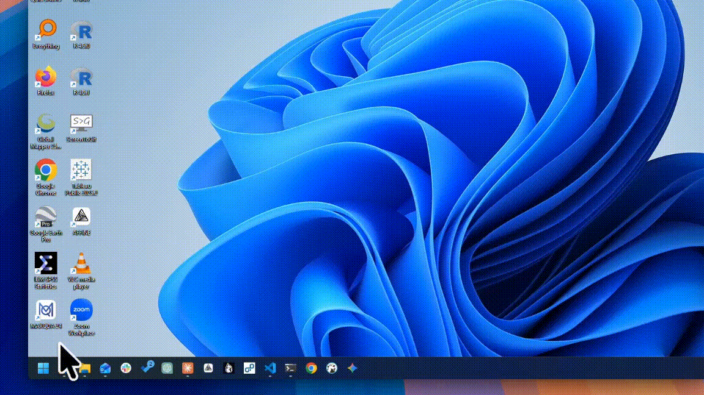
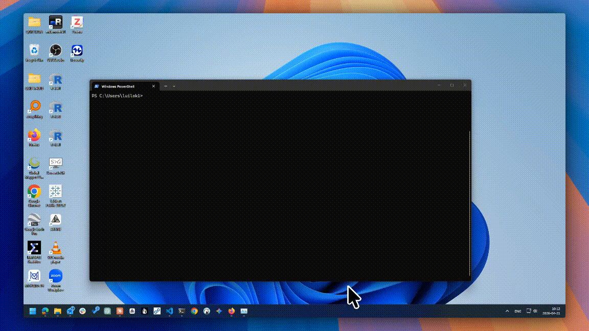
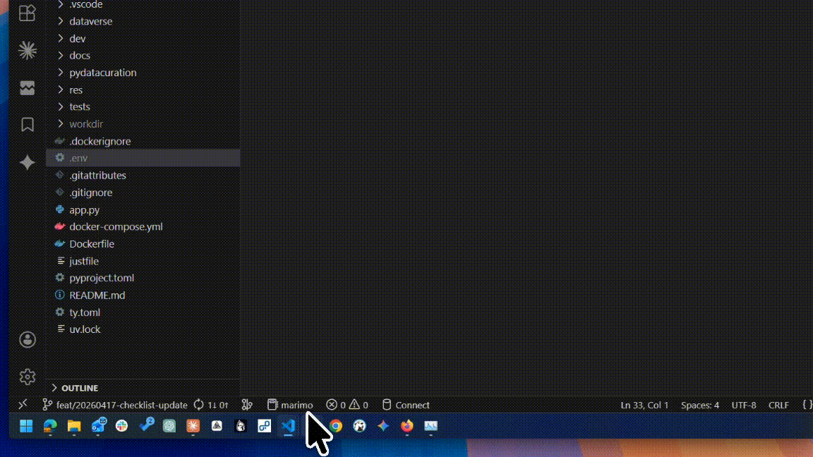

Restart instructions
===


To restart the U of T Dataverse Curation Tool on a Windows local machine, follow the steps below:

## Steps
1. Open a PowerShell terminal.
      
      { width="800" }

2. Type (or copy and paste) the following command to change your terminal's directory to the *pydatacuration-p* folder:
   ```powershell
   cd pydatacuration-p
   ```

      { width="800" }

3. Once you are in the *pydatacuration-p* folder, you can run the following command to update the tool to the latest release:
      ```powershell
      git fetch --tags; git switch --detach (git describe --tags --abbrev=0 origin/main)
      ```

      Git may show a message about being in a 'detached HEAD' state. This is expected: the tool is on a release rather than a branch.

4. Finally, run the application in the PowerShell terminal using the following command:
   ```powershell
   uv run --env-file .env app.py
   ```

      { width="800" }

      You should be able to access the tool at http://localhost:9005 in your web browser.

## Close the application
To close the application, simply press `Ctrl + C` in the PowerShell terminal.

!!! danger "API Token security tip"

    A best security practice is to revoke the API Token in Borealis after you are done using the tool. You can generate a new API token for the next time you use the tool.
